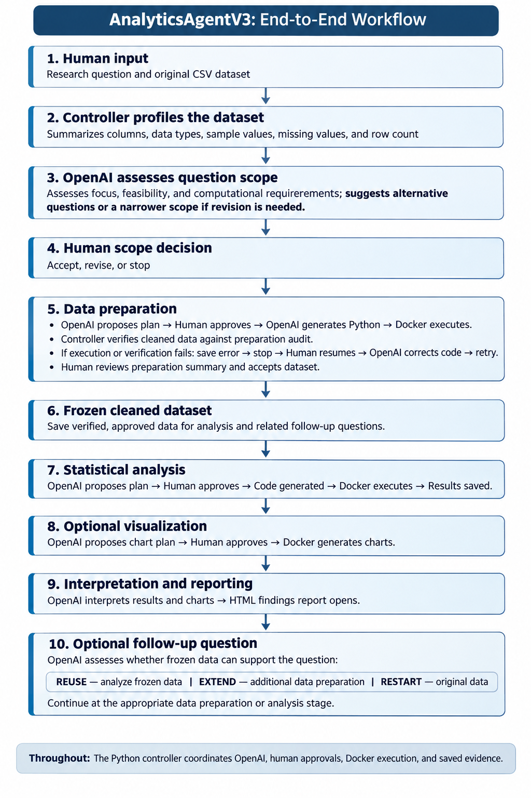

# Lessons Learned: Building an AI Analytics Agent

## Introduction

AnalyticsAgentV3 is a prototype AI agent that performs data preparation, statistical analysis, visualization, and interpretation using Python, OpenAI, and Docker.

An AI agent is a program that uses a large language model (LLM), such as OpenAI's GPT, to carry out multi-step tasks. Docker provides an isolated environment for executing code.

The project explored how AI agents could assist analytics professionals while maintaining human oversight. Development involved several iterations, debugging, testing, and independent reviews.

Five lessons emerged.

## 1. Agent Architecture: Separate Responsibilities

An important distinction is between designing the agent's workflow and using AI to plan analytical work.

The workflow defines what happens, in what order, and what requires approval or verification. The LLM develops analytical plans and generates code within those rules.

The controller is the Python program that manages this workflow. It calls OpenAI, requests human approvals, executes code through Docker, and checks results.

### AnalyticsAgentV3: End-to-End Workflow

Our architecture separates five responsibilities:

- Planning: OpenAI proposes analytical steps in plain language before generating code.

- Approval: The human reviews consequential analytical choices.

- Execution: Generated Python code runs inside Docker.

- Verification: The controller checks that the cleaned dataset is consistent with the preparation audit.

- Interpretation: OpenAI explains results and supports follow-up questions.

The preparation audit records the number of input rows, excluded rows and reasons for exclusion, output rows, and remaining missing values.

This separation allows some errors to be detected before they affect subsequent analysis, although it cannot guarantee correctness.

## One LLM or Two?

Earlier versions used OpenAI for generation and Claude for independent review. The final runtime architecture uses OpenAI alone, supported by deterministic verification and execution feedback.

A second LLM can identify errors, but adds cost, latency, and complexity. Agreement between models does not guarantee correctness.

Claude remained valuable as an independent reviewer during development.

**Lesson:** Choose the number of LLMs based on demonstrated needs, not the assumption that more models necessarily produce better results.

## 2. Human Oversight: Focus on Consequential Decisions

Human oversight is essential, but it should concentrate on decisions requiring analytical judgment.

In AnalyticsAgentV3, the human reviews proposed plans in plain language and examines preparation audit results. These reviews address assumptions, exclusions, and analytical methods rather than every line of generated Python code.

For example, when analyzing the Divvy bike-share data, we questioned a proposed 24-hour trip-duration cutoff because it lacked independent justification. The primary analysis retained valid long trips, while the cutoff became an optional sensitivity analysis.

For follow-up questions, the agent evaluates whether the previously cleaned dataset contains sufficient information. It can:

- Reuse the existing dataset.

- Extend it through additional preparation.

- Restart preparation from the original data.

The saved, unchanged cleaned dataset is called the frozen dataset. Reusing it avoids unnecessary data preparation and maintains consistency across related analyses.

The agent determines whether the frozen dataset can support a follow-up question. The human reviews and approves the proposed analytical plan before execution.

**Lesson:** Human oversight should focus on domain knowledge, assumptions, and analytical judgment rather than routine technical details.

## 3. Execution Controls: Separate Generated Code from the Controller

AI-generated code can contain errors or behave unexpectedly, potentially overwriting files or consuming excessive computing resources.

AnalyticsAgentV3 therefore executes generated Python scripts inside a Docker container rather than directly in the controller's environment.

Docker restricts network access, filesystem access, memory, and CPU usage. These restrictions reduce certain risks but do not provide a complete security guarantee.

The controller also preserves generated code, preparation audits, statistical results, and charts. These artifacts support verification, reproducibility, and recovery from interrupted or failed runs.

**Lesson:** Execution controls and evidence preservation should be incorporated into an analytics agent from the beginning.

## 4. Verification and Recovery: Expect Errors

Even plausible AI-generated code can fail during execution.

During our February 2025 Divvy test, OpenAI generated Python code that attempted to apply .fillna(), a pandas method, to a NumPy array, which does not support that method.

The run stopped. The controller saved the error message. When the human restarted the controller and resumed the run, OpenAI received the error and generated working replacement code.

Independent testing also identified weaknesses in our recovery mechanism, including a risk that an old audit file could be mistaken for the current one. We corrected these problems.

The controller verifies that the prepared dataset matches its audit in row counts, exclusions, and missing values. However, these checks do not establish that all analytical methods or conclusions are correct.

**Lesson:** Reliability requires detecting errors, preserving evidence, and supporting recovery—not assuming AI-generated code will always work.

## 5. Simplicity: Justify Every Additional Control

During development, we repeatedly considered adding safeguards, review stages, and more elaborate workflow logic.

Each addition might improve reliability but also increases complexity, cost, or maintenance requirements.

We adopted a guiding principle: add a control only when its purpose and value can be justified.

For example, we retained Docker restrictions and preparation verification but removed the second LLM from the runtime workflow.

We also reused the frozen dataset for related follow-up question, avoiding unnecessary repeated data preparation.

**Lesson:** A relatively simple, understandable agent with essential controls may be more useful than a complicated system whose behavior is difficult to explain or maintain.

## Results and Limitations

AnalyticsAgentV3 successfully processed approximately 5.55 million Divvy bike-share trips from 2025, generated statistical results and visualizations, and answered a seasonal follow-up using the frozen dataset. A separate February analysis also completed the full workflow.

These results demonstrate feasibility, not general reliability across different datasets and analytical problems.

Two limitations remain. If a follow-up analysis is interrupted, resuming it may lose some context. When a follow-up requires additional data preparation, its audit may report only the new exclusions rather than the complete preparation history.

Broader testing would be necessary before operational deployment.

## Conclusion

Our central finding is that an effective analytics agent requires more than a capable LLM.

Its usefulness depends on workflow design, analytical judgment, controlled execution, verification, recovery, and human oversight.

The objective is not to remove the analytics professional from the process, but to make analytical work more efficient while preserving accountability and understanding.
